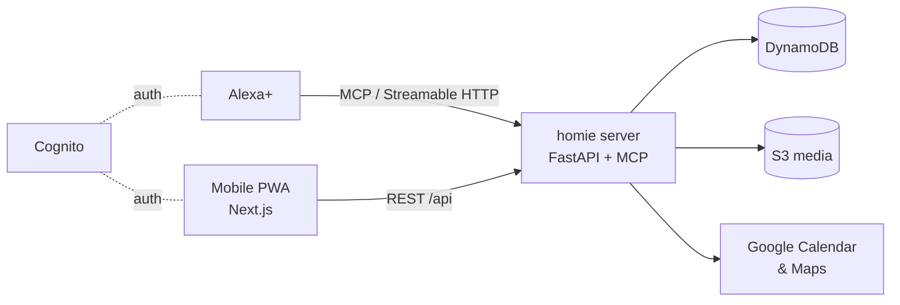

<div align="center">

# 🏠 homie

**Tell Alexa where things are, what you like, and what you need to do. homie remembers and helps you act on it.**

An Alexa+ memory assistant with Google Calendar and Google Maps, built for the
[Amazon Developer Hackathon 2026](https://amazonappdev2026.devpost.com/) (Alexa+ track).

[](https://github.com/dntrAnh/homie/actions/workflows/ci.yml)
[](https://amazonappdev2026.devpost.com/)
[](https://modelcontextprotocol.io/)

[](server/pyproject.toml)
[](https://fastapi.tiangolo.com/)
[](https://nextjs.org/)
[](https://react.dev/)
[](https://tailwindcss.com/)
[](infra/terraform)
[](infra/terraform)

</div>

---

## ✨ What it does

| | |
|---|---|
| 🧠 **Remembers for you** | "Alexa, my passport is in the top desk drawer." Later: "Where's my passport?" |
| 📅 **Reminders in your calendar** | Ask for a deadline or food-expiry reminder; it lands in Google Calendar with linked to-dos. |
| 🗺️ **Places that fit you** | Place suggestions and routes from Google Maps, ranked by the preferences you've told it. |
| 📱 **You stay in control** | A mobile-first, installable PWA to view, edit and delete everything homie stores, including photos and videos. |

## 🏗️ How it works



Alexa+ talks to the backend as an **MCP server** (spec 2025-11-25, Streamable HTTP). The dashboard uses the same
server over REST. Every read and write is scoped to the signed-in user.

## 🚀 Quick start

**Prerequisites:** [uv](https://docs.astral.sh/uv/), [bun](https://bun.sh/), and Docker (optional).

```sh
# backend → http://localhost:8000/docs
cd server && cp .env.example .env && uv sync && uv run fastapi dev app/main.py

# frontend → http://localhost:3000
cd client && cp .env.example .env.local && bun install && bun dev   # also installs the pre-commit hook
```

Or run the whole stack:

```sh
docker compose -f infra/docker-compose.yml up --build
```

## 🧪 Checks

| | server/ | client/ |
|---|---|---|
| test | `uv run pytest` | — |
| lint | `uv run ruff check .` | `bun run lint` |
| format | `uv run ruff format .` | `bun run format` |

CI runs server, client and Terraform checks on every PR.

## 📁 Repo layout

```
server/   FastAPI backend + MCP server (uv)  — app/{routes,services,models}
client/   Next.js 16 PWA (bun, shadcn/ui, Tailwind 4)
infra/    Docker, docker-compose, Terraform (AWS)
docs/     design spec, implementation plans, spikes
```

## 📚 Docs

- [P0 design spec](docs/superpowers/specs/2026-10-03-p0-design.md): architecture, data model, MCP tools, REST API
- [Plan 1: foundation + memory](docs/superpowers/plans/2026-10-03-p0-plan-1-foundation-memory.md)
- [Alexa ↔ Cognito account-linking spike](docs/superpowers/spikes/2026-10-04-alexa-cognito-auth.md)
- [AGENTS.md](AGENTS.md): conventions and workflow for contributors (human or AI)
